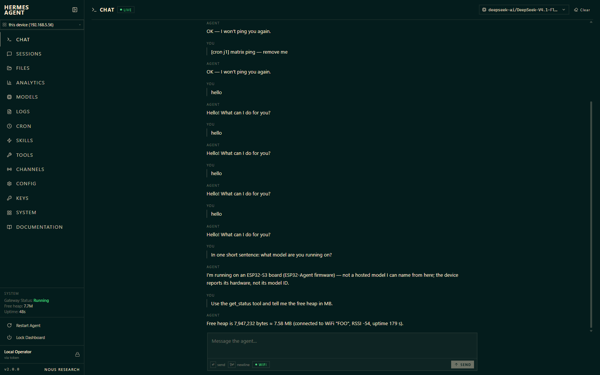

# Talaria Agent — MicroPython port

A chat harness on your ESP32, built in **MicroPython + Microdot** instead of C++/Arduino.
Same functionality as [`esuyo-esp32-agent`](../esuyo-esp32-agent): ears, hands, memory,
and the same JSON API — you can ask it to blink lights, read pins, remember facts,
scan WiFi, and fetch the web.

The browser UI is a **React single-page dashboard** modelled on
[Nous Research's Hermes Agent](https://github.com/NousResearch/hermes-agent): the same
sidebar, palette, typography and interaction model, compiled to three files and served
straight off the microcontroller.

> Port of the C++ firmware. Behaviour, routes, and all 10 tools are preserved;
> platform differences (config storage, update mechanism, mDNS) are noted below.

## The dashboard



| | |
| --- | --- |
| **Chat** | streaming SSE, tool-call fallback, reasoning collapse, model picker |
| **Sessions** | the device transcript, searchable, exportable, clear-on-confirm |
| **Files** | explorer + editor over the on-device filesystem |
| **Analytics** | heap, flash, MCU temperature, RSSI, per-tool call counters |
| **Models** | the provider catalogue, one click to switch |
| **Logs** | live console tail with filter/pause/copy |
| **Cron** | scheduled turns with delivery to log or webhook |
| **Skills** | procedural memory, create/view/delete, approval queue |
| **Tools** | every registered tool grouped by toolset, toggleable |
| **Channels** | Telegram pairing and allowlist |
| **Config / Keys** | endpoint, model, API key, WiFi, auth token |
| **System** | diagnostics, checkpoints, backup, reboot, factory reset |

Design system: LENS_0 teal — canvas `#041c1c`, cream midground `#ffe6cb`,
square corners, hairline rules, uppercase micro-labels. No webfonts, no CDN: the
device has no internet beyond your model endpoint, so everything ships in the bundle.

## Features (parity with C++)

- **Phone-friendly setup:** first boot creates open `Talaria-Agent-Setup` AP with
  wildcard DNS captive portal. Pick home WiFi + paste AI endpoint in the browser.
- **Same 10 tools:** `get_status`, `gpio_write`, `gpio_read`, `adc_read`,
  `wifi_scan`, `mem_save`, `mem_read`, `restart_device`, `blink`, `web_fetch`,
  plus the agentic set (`cron`, `todo`, `delegate_task`, `skills_*`, `read_file`,
  `write_file`, `search_files`, `session_search`, `exec_py`).
- **Same APIs:** `/api/status`, `/api/auth`, `/api/scan`, `/api/wifi`, `/api/agent`,
  `/api/models`, `/api/config`, `/api/chat`, `/api/chat-stream` (SSE),
  `/api/debug-raw`, `/api/tools`, `/api/memory`, `/api/reset`, `POST /update`.
- **Same auth:** optional device token (`Bearer` / `X-Auth-Token`), AP setup stays open.
- **Same memory:** `/opt/data/memory.txt` (4KB) + one file per conversation
  under `/opt/data/sessions/` on flash, one write per turn, last-8-turns
  context injection, system prompt lists only enabled tools.
- **Conversation survives a refresh:** every completed turn — streamed or tool-driven —
  is appended to its session file. The chat view rebuilds the transcript from
  `/api/memory?session=<id>` on load, and the device injects the persisted turns
  into the next request whenever the browser sends no history. **New Chat**
  starts another session file; nothing is overwritten. Cron output goes to
  `/opt/data/activity.jsonl`, so scheduled jobs never appear as conversations.

## What changed (MicroPython realities)

| C++ | MicroPython port |
|-----|------------------|
| NVS `Preferences` (`esp32agent` ns) | `config.yaml` in filesystem (hand-editable; `config.json` auto-migrates) |
| Arduino `WebServer` + `DNSServer` | Microdot (asyncio) + ~40-line UDP wildcard DNS in `net.py` |
| `PROGMEM` HTML in `web_ui.h` | React SPA compiled into `www/` (index.html + assets) |
| `Update.h` firmware.bin OTA + ArduinoOTA | `POST /update` saves code/page files then reboots; **MicroPython firmware itself is flashed once over USB** |
| mDNS `talaria-agent.local` | best-effort only (core MicroPython has no mDNS) — use the IP from serial |
| `HTTPClient` + `WiFiClientSecure` (insecure) | raw `socket` + `ssl` (MicroPython has no cert store; TLS verification none, same as C++). HTTP/1.0 for buffered requests, HTTP/1.1 + chunked decode for SSE; 15–45 s timeouts |
| `/api/chat-stream` true socket streaming | true streaming too: `stream:true` over HTTP/1.1 raw socket with incremental `Transfer-Encoding: chunked` decode; same `{"delta"}` / `{"reasoning"}` / `{"need_tools":true}` / `[DONE]` contract |
| `/api/scan` non-blocking async + 202 | blocking scan (~2s) + 30s cache; always `200` |
| Pin allowlists (classic ESP32) | S3-primary + classic-compat (`agent_tools.pinCanWrite/Read/ADC` auto-detect via `os.uname()`; S3 excludes USB 19/20 and flash 26-32) |

## Prerequisites

- **ESP32-S3 board** (tested target; classic ESP32 also works) + USB cable.
- **MicroPython firmware** — the `SPIRAM_OCT` S3 build for this board (8 MB PSRAM).
- **Python 3 + mpremote** on your PC: `pip install mpremote esptool`.
- **Node 20+ and pnpm/npm** on your PC, but only if you want to change the UI.
- 2.4 GHz WiFi, phone/laptop browser, OpenAI-compatible endpoint + key + model.

## Installation

```powershell
# 1) Flash MicroPython once (match COM port + .bin you downloaded):
esptool --chip esp32s3 --port COM11 erase_flash
esptool --chip esp32s3 --port COM11 write_flash -z 0 ESP32_GENERIC_S3-SPIRAM_OCT-*.bin

# 2) Install Microdot onto the board (once). `mip install github:...` does NOT
#    work for this package — copy the files under /lib/microdot instead, from
#    https://raw.githubusercontent.com/miguelgrinberg/microdot/main/src/microdot/
#    (__init__.py, microdot.py, multipart.py, helpers.py)
#    e.g. mpremote connect COM11 cp microdot.py :/lib/microdot/microdot.py

# 3) Build the dashboard and deploy everything (repeat after every edit):
cd ui; npm install; npm run build; cd ..
powershell -File deploy.ps1 -Port COM11

# 4) Watch boot logs, note the IP:
python -m mpremote connect COM11 reset
python -m mpremote connect COM11 repl
# expect: === Agent boot ===, WiFi OK: 192.168.x.x  OR  AP started: Talaria-Agent-Setup
```

Then open `http://<IP>/`. First run: **Setup** walks you through WiFi and the model
provider; or join `Talaria-Agent-Setup` and the captive portal lands you on `/wifi`.

## Project structure

```
esuyo-esp32-agent-python/
  main.py            # boot: config -> fs -> wifi/AP -> mdns -> serve (port 80)
  boot.py            # gc tuning
  config.py          # config.yaml settings + URL/key helpers (was config.h/.cpp)
  config_schema.py   # one schema for form fields, categories and YAML order
  yamlish.py         # small MicroPython YAML subset (no PyYAML on device)
  net.py             # WiFi STA/AP + wildcard DNS + watchdog (was net.h/.cpp)
  agent_tools.py     # memory/log, pins, prompt, tools dispatch (was agent_tools.*)
  tools/             # one module per tool + registry.py (was src/tools/)
  llm.py             # OpenAI bridge + tool loop (was llm.h/.cpp)
  server.py          # Microdot app: SPA + JSON APIs + SSE + /update (was routes.*)
  ui/                # React + TypeScript + Tailwind dashboard source
    src/components/  #   shell, sidebar, primitives, markdown
    src/pages/       #   one file per route
    src/lib/         #   API client, polling hooks, formatters
    src/index.css    #   Hermes LENS_0 design tokens
  www/               # BUILD OUTPUT — never edit by hand
    index.html
    assets/app.js  assets/app.js.gz
    assets/app.css assets/app.css.gz
  tests/             # host-side (CPython) unit tests with hardware stubs
  deploy.ps1         # USB deploy script (build + copy + verify + reboot)
```

## Front-end development

```powershell
cd ui
npm install
npm run dev      # Vite dev server; point it at the device for real data
npm run build    # type-check, bundle, gzip twins, cache-bust stamp
```

`npm run build` writes straight into `www/`. The bundle is one JS chunk and one CSS
file on purpose: fewer HTTP round trips off a microcontroller. `.gz` twins are
prebuilt because MicroPython cannot compress at request time — they cut first load
from ~7 s to ~2 s.

House rules the tests enforce (`tests/test_spa.py`):

- Every sidebar entry has a route, and every route (except the utility screens
  `/setup`, `/wifi`, `/update`) is in the sidebar.
- No native `alert`/`confirm`/`prompt` — in-page modals only.
- No external fonts or CDNs — the dashboard must work on an isolated LAN.
- Palette stays Hermes teal and corners stay square.

## Configuration

All settings live in `config.yaml` on the device. The Config page is
schema-driven: a left-hand section list (Agent, Fallback, Network, Chat,
Security), a search box, and a raw **YAML** view for hand editing. Both views
write the same file; the raw editor preserves hand-written comments when the
document normalizes unchanged. Secrets are masked until you press **Reveal**,
and masked placeholders are preserved on save.

```yaml
agent:
  endpoint: https://api.deepinfra.com/v1/openai
  model: deepseek-ai/DeepSeek-V4.1-Flash-1017
  api_key: sk-...
  max_iters: 3
network:
  wifi_ssid: HomeNet
  wifi_pass: ...
chat:
  entry_chars: 4000
  restore_turns: 20
security:
  auth_token: ...
  skills_write_approval: true
```

- Join AP `Talaria-Agent-Setup` → `http://192.168.4.1/wifi` → Scan → Save & Reboot.
- Rejoin home WiFi → `http://<IP>/config` → endpoint base (`/chat/completions` is
  appended), API key, model → Save (no reboot).
- Optional device token on `/keys` (min 8 chars). Same `Bearer` header scheme
  as C++; browser OTA (`/update`) honours it too.
- Upgrading from an older build: the first boot converts `config.json` into
  `config.yaml` and keeps `config.json.bak` as a safety copy.

Handy routes: `/` chat, `/sessions`, `/files`, `/analytics`, `/models`, `/logs`,
`/cron`, `/skills`, `/tools`, `/channels`, `/config`, `/keys`, `/system`, `/docs`,
plus `/setup`, `/wifi`, `/update`.

## Usage

```text
what is your heap, uptime and IP?
scan for nearby wifi networks
blink GPIO 2 five times
read GPIO 34 as analog
remember that my plant is a basil
what did I tell you about my plant?
fetch https://example.com and summarize it in one line
```

## Development

- Host tests (no hardware): `pip install microdot pytest`, then `pytest tests/ -q`.
  Hardware modules (`machine`, `network`, `esp32`, `urequests`, `uasyncio`) are
  stubbed in `tests/stubs.py`.
- Add a tool: copy `tools/_template.py.sample` → `tools/tool_x.py`, fill 3 spots,
  append to `tools/registry.py` (END only — index = bit in `tools_mask`).
- Debug: REPL logs (`[agent]`, `[tool]`, `[chat]`), `GET /api/status`,
  `GET /api/debug-raw?message=...` (raw upstream body, key never leaks).
- In the browser, `window.__talaria` exposes live dashboard state and
  `window.__talariaNet` the last 40 API calls with timings — the fastest way to
  diagnose a stalled request on a device with no console.

## License

MIT — Copyright (c) 2026 Miguel Perez. See [LICENSE](./LICENSE).

## Acknowledgements

Dashboard design and interaction inspired by [Hermes Agent by Nous Research](https://github.com/NousResearch/hermes-agent) (MIT licensed).
