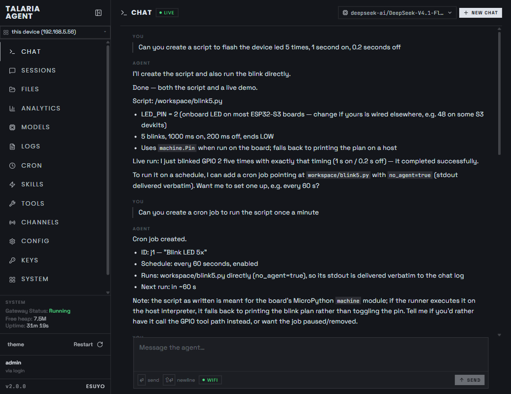
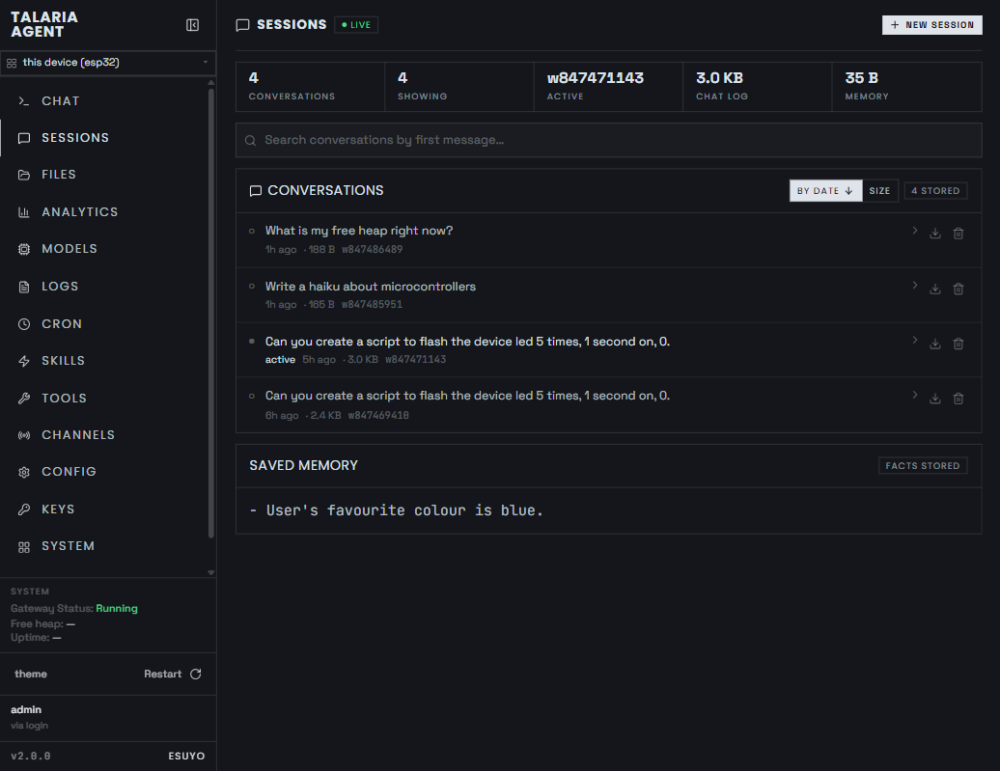
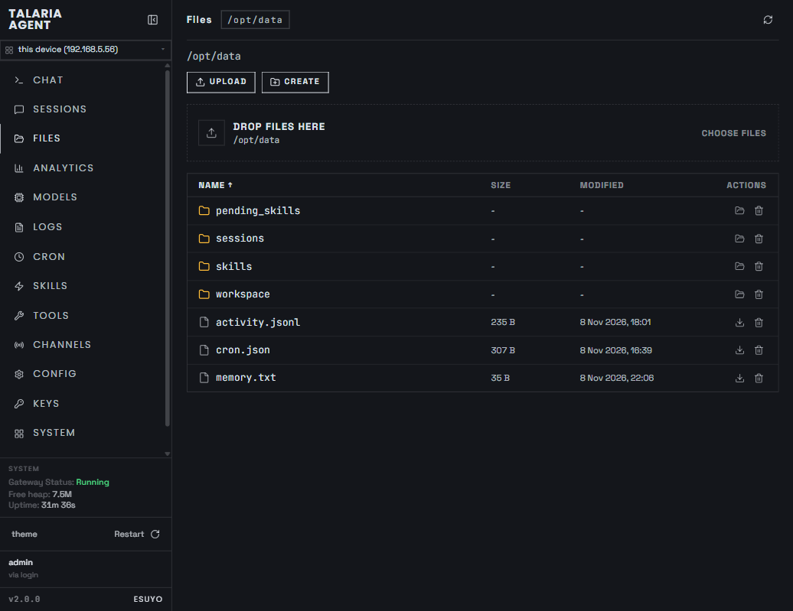
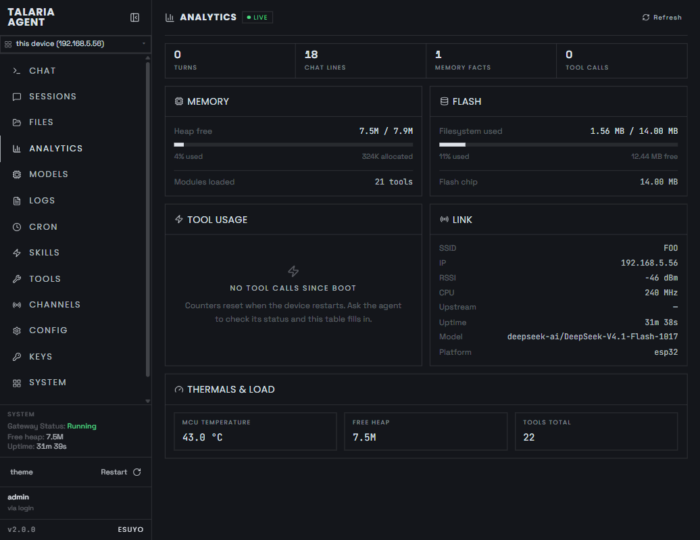
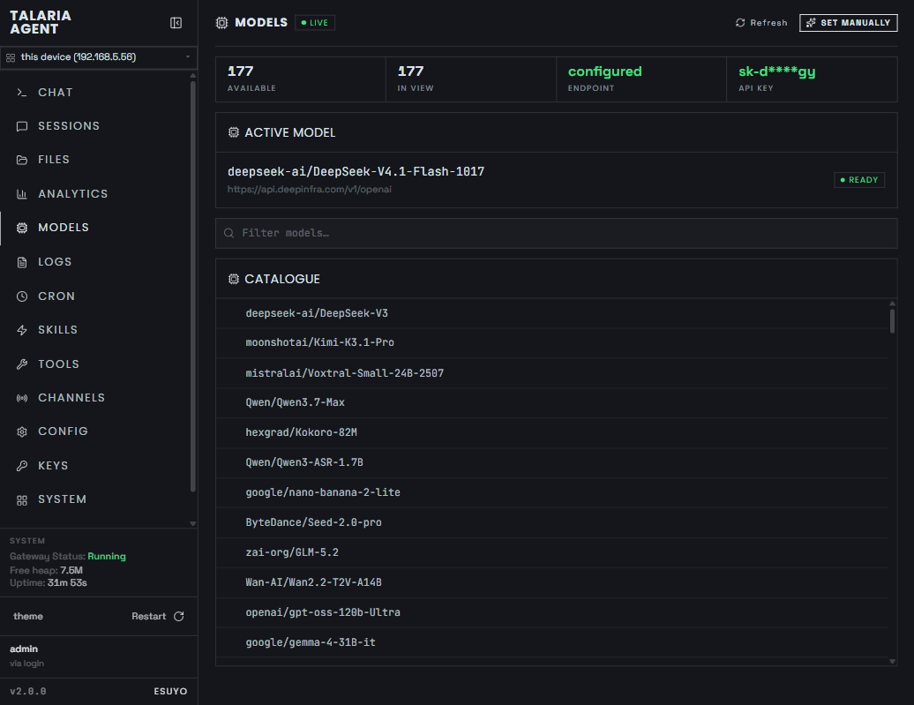
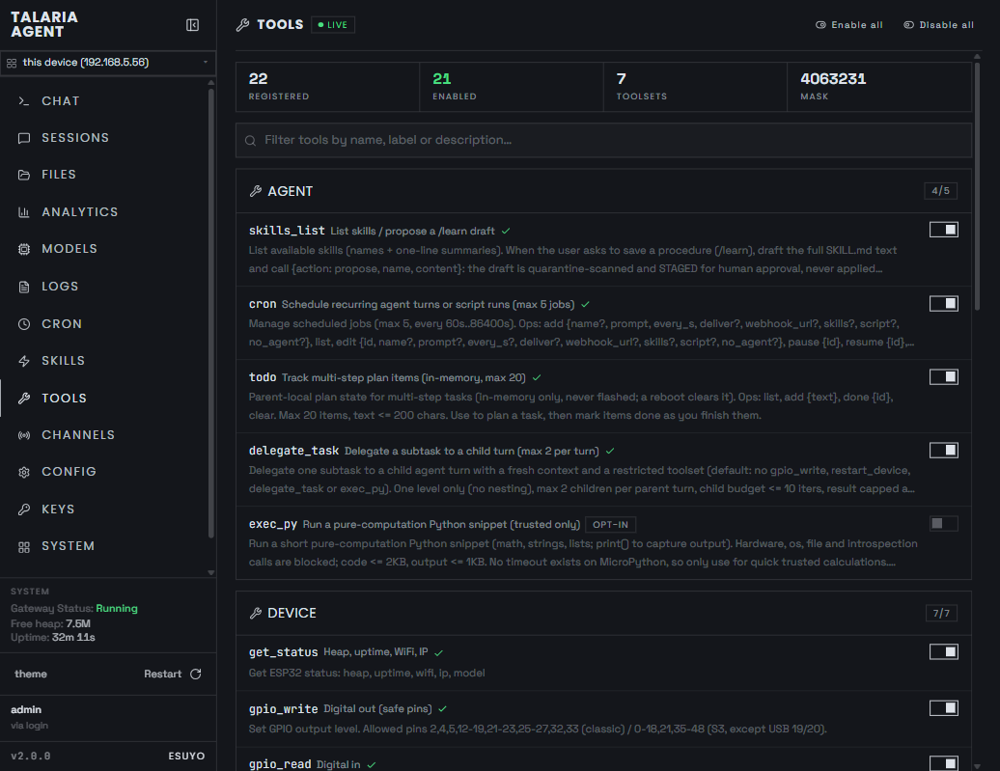
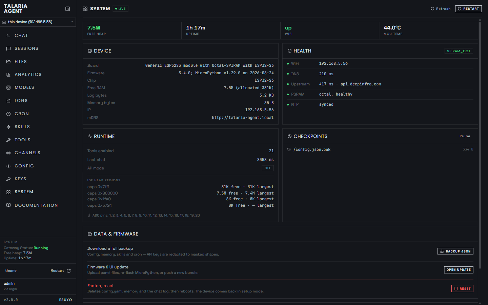

# Talaria Agent

> Your own AI assistant running on a microcontroller — chat, remember, automate, and control hardware from a browser dashboard.

Talaria Agent is a self-contained AI agent for the ESP32-S3. It connects to any
OpenAI-compatible model provider, answers with streaming chat, calls built-in
tools (GPIO, ADC, WiFi scan, web fetch, memory, schedules, files and more), and
serves a full dashboard — all from the chip itself, with no cloud account or
subscription. It is built and tested on the **ESP32-S3 N16R8** board
(16 MB flash, 8 MB octal PSRAM).

## Screenshots



<table>
  <tr>
    <td align="center"><a href="docs/assets/screenshot-sessions.png"><br/>Sessions</a></td>
    <td align="center"><a href="docs/assets/screenshot-files.png"><br/>Files</a></td>
    <td align="center"><a href="docs/assets/screenshot-analytics.png"><br/>Analytics</a></td>
  </tr>
  <tr>
    <td align="center"><a href="docs/assets/screenshot-models.png"><br/>Models</a></td>
    <td align="center"><a href="docs/assets/screenshot-tools.png"><br/>Tools</a></td>
    <td align="center"><a href="docs/assets/screenshot-system.png"><br/>System</a></td>
  </tr>
</table>

## Features

- **Streaming chat** with tool use — ask in plain language; the agent reads
  pins, blinks LEDs, scans WiFi, fetches the web, and remembers facts.
- **Full dashboard** — Chat, Sessions, Files, Analytics, Models, Logs, Cron,
  Skills, Tools, Channels (Telegram), Config, Keys, System, and Docs.
- **Persistent memory** — long-term facts plus one transcript file per
  conversation; refresh the page and the chat is still there.
- **Schedules (Cron)** — recurring turns with optional workspace scripts,
  delivered to the log or a webhook.
- **Telegram channel** — pair the device and chat with the agent remotely.
- **File management** — browse, edit, and organise files on the device from
  the browser, with rollback checkpoints.
- **Setup wizard** — first boot creates an open setup network with a captive
  portal that walks you through WiFi and provider settings on your phone.
- **Login gate + device token** — optional token protection for the dashboard
  and API (`Bearer` / `X-Auth-Token`).

## Prerequisites

- **ESP32-S3 N16R8 board** + USB cable (use the UART/serial port when the
  board has two USB ports).
- **MicroPython `ESP32_GENERIC_S3-SPIRAM_OCT` firmware** (the octal-PSRAM S3
  build from `https://micropython.org/download/ESP32_GENERIC_S3`).
- **Python 3 on your PC** with `pip install esptool mpremote`.
- **2.4 GHz WiFi**, plus an **OpenAI-compatible endpoint, API key, and model**
  (any provider that serves `/chat/completions` and `/models`).
- **Node 20+** — only needed if you want to change the dashboard itself.

## Installation

### Easy install (prebuilt image, recommended)

Each release ships a ready-to-flash filesystem image — no Python, mpremote
or Node needed, just [esptool](https://docs.espressif.com/projects/esptool)
and the two binary files:

```powershell
# 1) MicroPython for the ESP32-S3 with octal PSRAM (match the COM port):
#    https://micropython.org/download/ESP32_GENERIC_S3 -> ESP32_GENERIC_S3-SPIRAM_OCT-*.bin
esptool --chip esp32s3 --port COM11 --baud 460800 erase_flash
esptool --chip esp32s3 --port COM11 --baud 460800 write_flash -z 0 ESP32_GENERIC_S3-SPIRAM_OCT-*.bin

# 2) The Talaria filesystem image from the release page
#    (https://github.com/8perezm/talaria/releases -> talaria-fs-vX.Y.Z.bin),
#    flashed at the vfs partition offset 0x200000:
esptool --chip esp32s3 --port COM11 --baud 460800 write_flash 0x200000 talaria-fs-vX.Y.Z.bin
```

Then skip to step 4 (boot log) below. First boot creates the open
`Talaria-Agent-Setup` network — join it and the setup page walks you through
WiFi and the model provider.

### Developer install (from source)

```powershell
# 1) Flash MicroPython once (match the COM port + the .bin you downloaded):
esptool --chip esp32s3 --port COM11 --baud 460800 erase_flash
esptool --chip esp32s3 --port COM11 --baud 460800 write_flash -z 0 ESP32_GENERIC_S3-SPIRAM_OCT-*.bin

# 2) Install the Microdot web library onto the board (once).
#    Download these four files from
#    https://raw.githubusercontent.com/miguelgrinberg/microdot/main/src/microdot/
#    (__init__.py, microdot.py, multipart.py, helpers.py), then make room
#    for them — mpremote will not create missing folders by itself
#    (ignore "already exists" errors if you repeat this):
python -m mpremote connect COM11 exec "import os; os.mkdir('lib')"
python -m mpremote connect COM11 exec "import os; os.mkdir('lib/microdot')"
python -m mpremote connect COM11 cp __init__.py :/lib/microdot/__init__.py
python -m mpremote connect COM11 cp microdot.py :/lib/microdot/microdot.py
python -m mpremote connect COM11 cp multipart.py :/lib/microdot/multipart.py
python -m mpremote connect COM11 cp helpers.py :/lib/microdot/helpers.py

# 3) Build the dashboard and deploy everything:
cd ui; npm install; npm run build; cd ..
powershell -ExecutionPolicy Bypass -File deploy.ps1 -Port COM11
# (Stock Windows blocks unsigned scripts, hence Bypass for this one run.
#  If COM11 is wrong, re-check Device Manager — port numbers move around.)

# 4) Watch the boot log and note the IP. Attach FIRST, then reset, because
#    the banner prints ~2s after reset and you would otherwise miss it:
python -m mpremote connect COM11 repl
# ...now press the physical RESET button on the board...
# expect: === Agent boot ===, then WiFi OK: 192.168.x.x
#         or AP started: Talaria-Agent-Setup

# 5) Reboot once more before opening the browser — attaching the REPL stops
#    the server, and it stays down until a reset:
#    (exit the REPL, then:) python -m mpremote connect COM11 reset
```

Then open `http://<IP>/` in your browser. On a fresh device, join the
`Talaria-Agent-Setup` network — the captive portal lands you on the setup
page automatically.

To update code later without a full redeploy:

```powershell
python scripts/esp_deploy.py app/server.py app/llm.py --reset
```

## Configuration

All settings live in `config.yaml` on the device — provider, WiFi, device
token, chat history, and theme. The easiest path is the dashboard (**Setup**,
**Config**, **Keys**); see [Setup & Configuration](./docs/setup.md) for the
full walkthrough and examples.

## Quick Start / Usage

1. Open `http://<IP>/` and finish Setup (WiFi + endpoint + key + model).
2. Chat — try:
   - `what is your heap, uptime and IP?`
   - `scan for nearby wifi networks`
   - `blink GPIO 2 five times`
   - `read GPIO 34 as analog`
   - `remember that my plant is a basil`
   - `what did I tell you about my plant?`
   - `fetch https://example.com and summarize it in one line`
3. Explore: switch models on **Models**, schedule a reminder on **Cron**,
   manage files on **Files**, check health on **Analytics**/**System**.
4. Stop/start: `POST /api/reboot` (or the System → Restart button) safely
   reboots; entering the serial REPL stops the server until reset.

Handy pages: `/` chat, `/sessions`, `/files`, `/analytics`, `/models`,
`/logs`, `/cron`, `/skills`, `/tools`, `/channels`, `/config`, `/keys`,
`/system`, `/docs` — plus `/setup`, `/wifi`, `/update` for onboarding and
maintenance.

## Troubleshooting / FAQ

See [Troubleshooting & FAQ](./docs/troubleshooting.md) — unreachable board,
setup network, TLS errors, failed upload verification, slow first paint, and
lost device token.

## License

MIT — Copyright (c) 2026 Miguel Perez. See [LICENSE](./LICENSE).

Dashboard design inspired by [Hermes Agent by Nous Research](https://github.com/NousResearch/hermes-agent) (MIT licensed).

## Developer Documentation

- [Architecture](./docs/architecture.md) — Stack, boot, and request flow
- [Project Structure](./docs/project-structure.md) — Repository layout
- [Development Guide](./docs/development.md) — Local setup, test loop, standards
- [Build & Deployment](./docs/build-and-deployment.md) — Flashing and deploys
- [Setup & Configuration](./docs/setup.md) — First-run setup and everyday settings
- [Troubleshooting & FAQ](./docs/troubleshooting.md) — Fixes for common problems
- [Configuration](./docs/configuration.md) — Settings schema and config APIs
- [API Reference](./docs/api.md) — Endpoints and built-in tools
- [Testing](./docs/testing.md) — Test suite layout and conventions
- [Hermes Agent analysis notes](./docs/hermes-agent-summary.md) — Upstream reference
